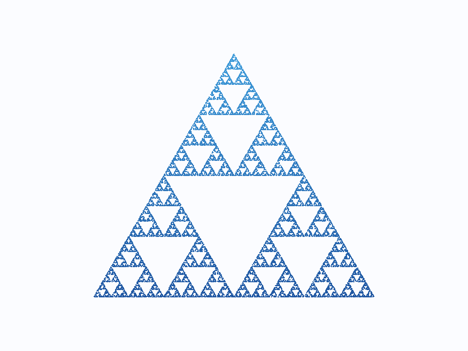
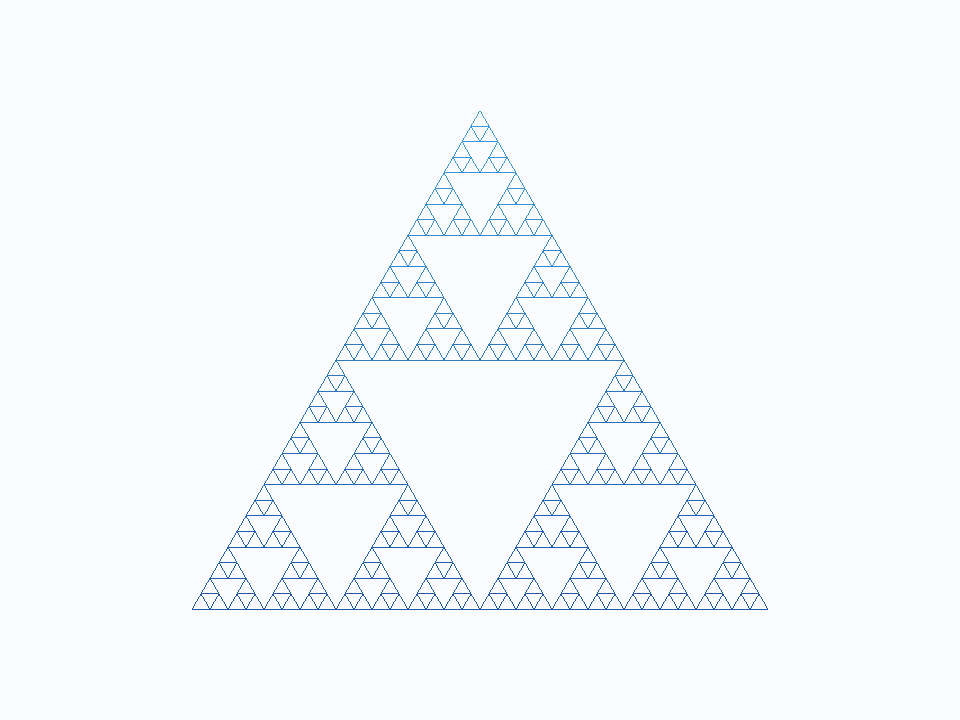

# AP1：交互式二维分形

姓名：________　学号：________　班级：________

## 1. 运行地址与提交内容

**可运行 URL：** https://ap1-fractal-student-20261012.milkyhare4.chatgpt.site

提交在线 URL、源码 ZIP、本 README。ZIP 已包含源码、README.md、README.html 及 screenshots/ 下的三张渲染结果图。

本地运行：解压后双击 `index.html`。代码与样式已内嵌，该文件可单独复制到桌面。`源码入口.html` 保留分文件版本，需要与 Common/、js/、style.css 放在一起。也可在本目录执行 `python -m http.server 8000`，访问 `http://localhost:8000/`。

`README.html` 可双击查看图文，图片已嵌入。Markdown 版本引用 screenshots/，应保留整个文件夹。

## 2. 两种算法的原理简述

### 2.1 混沌游戏

先在三角形内随机选初始点 p。每一步随机选一个顶点 v，计算 `p = (p + v) / 2`，保存新点并重复。三种中点映射把三角形缩小到三个角上的小三角形，中间区域不被覆盖，反复迭代后形成 Sierpinski 垫片。

程序先做 20 次预迭代，再存储设定数量的点。默认 20000 点，可调至 5000—100000 点，用 `gl.POINTS` 绘制。每次重新生成时点的位置有差别，整体形状保持一致。

### 2.2 递归细分

求三条边的中点，只保留三个角上的小三角形，再对它们递归；深度为 0 时保存当前三角形并停止。中间的倒三角形没有递归调用，因此形成空洞。

深度 d 产生 `3^d` 个叶子三角形，支持 0—6 层。点云在叶子内部采样，线框把每个叶子转成三条边，实体把每个叶子转成一个面，分别使用 POINTS、LINES、TRIANGLES。三种模式共用同一组叶子几何。有限深度的叶子仍有面积，因此递归点云与混沌游戏的细节不完全相同。

## 3. 交互操作说明

| 操作 | 效果 |
| --- | --- |
| 下拉框或 1 / 2 / 3 | 切换点云 / 线框 / 实体 |
| 算法下拉框 | 点云下选择混沌游戏或递归细分；线框和实体固定用递归 |
| 点数滑条 | 5000—100000 点，修改后重新生成并播放 |
| 深度滑条 | 递归深度 0—6；混沌游戏下禁用 |
| 点大小、配色 | 点大小 1—8 像素；蓝、橙红、绿三套配色 |
| 鼠标左键拖动 | 平移图形 |
| 滚轮 | 围绕光标缩放，倍率 0.2—20 |
| 空格或暂停按钮 | 暂停 / 继续点云生长 |
| 重新生长 | 同一组点从 0 再播放 |
| R 或复位按钮 | 恢复默认视图 |
| 导出当前 PNG | 保存当前画布 |

快捷键前先点击画布，避免焦点留在控件上。点云从 0 逐渐增长到设定点数，每秒约 6000 点，动画只增加 drawArrays 的绘制数量，不每帧重新上传 VBO。

选做 E1：混沌游戏可选择五、六边形并调移动比例。三角形比例固定为 0.5；五边形默认 0.618、六边形默认 0.667，作为观察重叠与空洞的实验预设。

## 4. 三种渲染模式结果图

<!-- SCREENSHOT_STATUS -->本包已附三张离屏渲染结果图：使用作业 geometry.js 生成的顶点数据与同一套 GLSL ES 着色器，在 OpenGL ES 环境绘制并读取画布图像。这些不是浏览器页面截图；若老师要求实际浏览器运行截图，可在线切换模式后截图，或从“截图与打包”页导出 WebGL 画布 PNG。

### 点云：混沌游戏，20000 点

### 线框：递归深度 5，243 个三角形

### 实体：递归深度 5，243 个三角形

## 5. 源码与引用

| 文件 | 作用 |
| --- | --- |
| index.html | 可双击运行的单文件入口 |
| 源码入口.html、style.css | 分文件入口与样式 |
| Common/ | 教材工具库 |
| js/geometry.js | 两种算法与顶点数据 |
| js/renderer.js | WebGL、VBO 与图元绘制 |
| js/interaction.js | 鼠标和键盘交互 |
| js/ui.js、js/main.js | 控件、状态与动画 |
| screenshots/ | 已附的三张模式图 |
| 截图与打包.html | 在线或静态服务器下导出实际浏览器画布并打包 |

教材：Angel & Shreiner, Interactive Computer Graphics, 8th ed.，第 2—3 章。Common/ 的 initShaders.js、MV.js、webgl-utils.js 来自教材作者仓库：https://github.com/esangel/WebGL/tree/master/Common ，保留原文件和版权说明。

代码和文档有 ChatGPT/Codex 辅助，范围见《AI辅助使用说明.md》。提交前应本人理解代码并遵守课程独立完成要求。已完成算法与模拟交互检查，以及同一着色器的离屏编译、链接和绘制；实际浏览器操作、截图和打包仍需运行核验。
